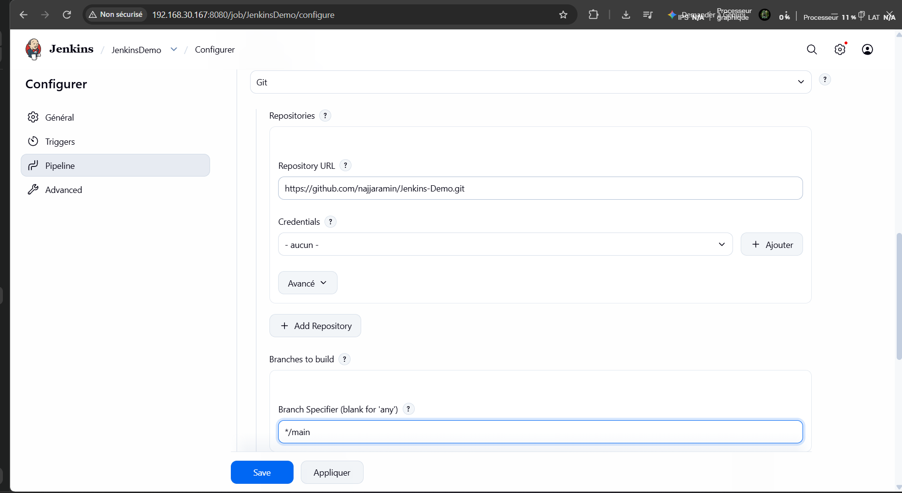
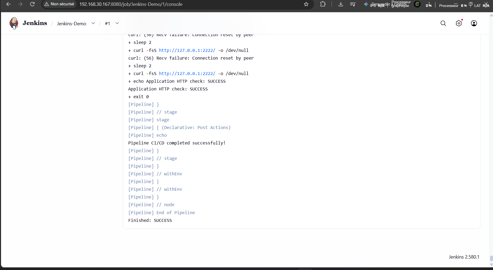
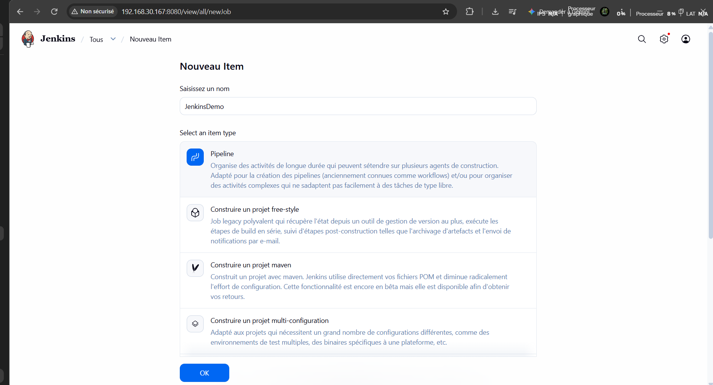

# Jenkins CI/CD — Spring Boot, Maven, Docker et Kubernetes

## Présentation

Ce projet présente des travaux pratiques DevOps avec Jenkins, Git/GitHub, Java, Maven, Docker et Kubernetes. Il couvre un job Freestyle, un pipeline déclaratif CI/CD et des exercices Kubernetes/Minikube documentés séparément.

## Objectifs

- Intégrer un dépôt GitHub dans Jenkins.
- Compiler et empaqueter une application Spring Boot avec Maven.
- Construire une image Docker et lancer un conteneur.
- Vérifier le statut du conteneur et la réponse HTTP.
- Documenter les étapes et les résultats avec des captures d'écran.

## Environnement technique

- **CI/CD :** Jenkins
- **Versioning :** Git et GitHub
- **Langage :** Java
- **Framework :** Spring Boot
- **Build :** Maven
- **Conteneurisation :** Docker
- **Orchestration :** Kubernetes / Minikube
- **CLI Kubernetes :** kubectl

## 1. Job Jenkins Freestyle

Un job Freestyle a été utilisé pour exécuter des commandes shell, récupérer le code source depuis Git et compiler/exécuter un programme Java.

Une planification périodique a été configurée avec :

```text
H/5 * * * *
```

Cette expression demande à Jenkins de planifier les exécutions à une fréquence approximative de cinq minutes.

## 2. Exercices Kubernetes / Minikube

Les résultats précédemment documentés pour cet exercice étaient :

- Deployment : `spring-app-deployment`
- Réplicas disponibles : `2/2`
- Service : `spring-app-service`
- Type : `NodePort`
- NodePort observé : `30517`
- Réponse HTTP observée : `200 OK`

Commandes de vérification :

```bash
kubectl get nodes
kubectl get deployments
kubectl get pods -o wide
kubectl get services
curl -i http://$(minikube ip):30517
```

Ces valeurs sont les résultats consignés précédemment ; elles ne confirment pas l'état actuel du cluster.

## 3. Pipeline CI/CD Jenkins avec Maven et Docker

Le job Pipeline `Jenkins-Demo` utilise le dépôt GitHub :

`https://github.com/najjaramin/Jenkins-Demo.git`

Configuration SCM :
- **SCM :** Git
- **Branche :** `*/main`
- **Script Path :** `Jenkinsfile`
- **Credentials :** aucune pour le dépôt public HTTPS

### Outils et plugins Jenkins

Plugins installés :
- Pipeline Maven Integration
- Docker Pipeline
- Kubernetes CLI
- Oracle Java SE Development Kit Installer

Outils configurés dans **Administrer Jenkins → Tools** :
- JDK : `JDK-21`
- Maven : `Maven-3`

Le pipeline utilise Maven et Docker. L'installation du plugin Kubernetes CLI ne signifie pas que ce pipeline réalise actuellement un déploiement Kubernetes.

### Étapes du pipeline

1. **Checkout** — récupération du code source depuis Git.
2. **Build App with Maven** — exécution de `mvn -B clean package`.
3. **Build Docker Image** — construction de l'image Docker avec un tag associé au numéro du build Jenkins.
4. **Deploy Docker Container** — remplacement de l'ancien conteneur puis lancement du nouveau.
5. **Verify Deployment** — vérification du conteneur et de la réponse HTTP.

Le `Jenkinsfile` contient un déclencheur de sondage SCM :

```groovy
triggers {
    pollSCM('H/5 * * * *')
}
```

Le déclenchement automatique après un nouveau `git push` doit être testé séparément.

### Dockerfile

Le Dockerfile utilise Eclipse Temurin 17 comme environnement Java d'exécution :

```dockerfile
FROM eclipse-temurin:17-jre
VOLUME /tmp
COPY target/devOpsDemo-0.0.1-SNAPSHOT.jar /app.jar
EXPOSE 2222
ENTRYPOINT ["java", "-jar", "/app.jar"]
```

### Vérification du déploiement

Commandes exécutées sur le serveur :

```bash
docker ps --filter "name=demo-jenkins"
curl -I http://127.0.0.1:2222/
```

Résultats observés :
- Conteneur `demo-jenkins` en état `Up`.
- Image : `demo-jenkins:1`.
- Port publié : `2222:2222`.
- Réponse HTTP : `200`.
- Console Jenkins : `Application HTTP check: SUCCESS` et `Finished: SUCCESS`.

La console montrait quelques erreurs temporaires de connexion au démarrage, puis la vérification HTTP a réussi.

### Captures d'écran

#### Création du job Pipeline



#### Configuration du dépôt Git



#### Résultat du pipeline



## 4. Commandes utiles

```bash
git status
git log -1 --oneline
docker ps --filter "name=demo-jenkins"
docker logs demo-jenkins
curl -I http://127.0.0.1:2222/
```

## 5. Améliorations possibles

- Tester le déclenchement du pipeline après un `git push`.
- Configurer un webhook GitHub si nécessaire.
- Publier l'image dans un registre Docker.
- Ajouter des tests automatisés et des contrôles de sécurité.
- Ajouter un déploiement Kubernetes automatisé si cela fait partie de la suite du laboratoire.
- Gérer les secrets avec Jenkins Credentials.

## Sécurité

Ne jamais publier de mot de passe Jenkins, de token GitHub, de clé privée SSH ou d'autres secrets. Vérifier les captures avant publication.

## Auteur

**Amin Najjar**

Projet pratique DevOps / CI-CD — Jenkins, Maven, Docker et Kubernetes.
